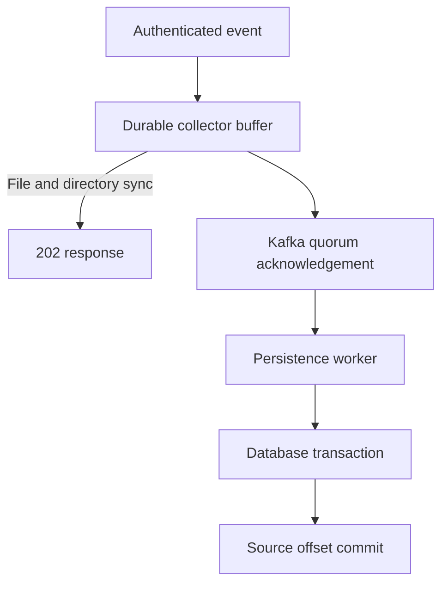

# Real-Time Telemetry Data Platform

Java 21 telemetry collection with bounded persistent buffering, registry-backed
Avro contracts, Kafka delivery and replay-safe PostgreSQL persistence.

The collector and persistence worker can run independently. Shared libraries own
admission, configuration, schema compatibility, metrics and trace propagation.

## Acceptance and recovery

`POST /v1/events` returns `202` **after the collector file and directory have
been synchronized to its persistent volume**. Kafka and database delivery happen
asynchronously. This survives process termination while the volume is retained;
it does not promise survival of the collector volume or an entire availability zone.

A full buffer rejects new events. Ambiguous requests must be retried with the
same event ID and payload. Kafka publication can repeat after a crash; the
database key and canonical fingerprint make an identical replay idempotent
within the configured data-retention window. A conflicting payload is quarantined.



## Components

| Module | Responsibility |
| --- | --- |
| `core` | Immutable event contracts, bounded admission, cancellation, queue deadlines and delivery ordering |
| `durable-buffer` | Exclusive volume ownership, checksummed records/checkpoints, durable append and replay |
| `event-schemas` | Published Avro versions, compatibility checks and bounded Schema Registry access |
| `platform-config` | Shared resource limits and production transport/authentication policy |
| `platform-observability` | Fixed-cardinality metrics and W3C trace propagation |
| `service` | Collector/worker runtimes, OAuth JWT authorization, Kafka adapters, SQL persistence and retention |

Avro envelope v2 adds an optional field with a default. Both old and new records
are tested with the current reader. This envelope evolution is separate from
the HTTP business contract's `schemaVersion: 1`.

## Build and verify

Requires JDK 21. Maven 3.9.12 is downloaded and checksum-verified by the wrapper.

```bash
./mvnw verify
```

The application distribution is a runnable JAR plus `service/target/lib/`.
Keep them together. The Docker image uses the same entry point:

```bash
java -jar service/target/telemetry-service-0.1.0-SNAPSHOT.jar
```

Actual execution results and remaining gates are recorded in
[verification.md](docs/verification.md). A written test or manifest is not a
passing result. Component overhead experiments are not data-pipeline capacity claims.

## Runtime profiles

- `collector`: HTTP intake, durable local volume and Kafka dispatch. No database
  connection is required.
- `worker`: Kafka consumption, PostgreSQL persistence, tenant-scoped retrieval
  and bounded retention sweeps.
- No role profile: both roles in one process, convenient for integration tests.
- `production`: refuses demo JWT mode, plaintext registry/broker connections
  and database connections without certificate/hostname verification.
- `replicated`: requests Kafka replication factor 3 and minimum ISR 2; it
  requires a separately provisioned cluster.

Run `./scripts/dev-up.sh`, then `./scripts/demo-event.sh`.
The collector listens on port 8080 and worker queries on 8082; see
[operations](docs/operations.md) for authentication and observability.

The local Compose stack uses generated demo credentials, loopback host ports and
one broker. Its fault model differs from the replicated deployment.

## Review

- [Design and fault model](docs/design.md)
- [Requirement-to-evidence map](docs/role-alignment.md)
- [Verification results](docs/verification.md)
- [Operations](docs/operations.md)
- [Performance methodology](docs/performance.md)
- [Contribution workflow](CONTRIBUTING.md)
- [Agent-assisted development](docs/agent-workflow.md)
- [Kubernetes deployment](deploy/helm/telemetry/README.md)
- [AWS infrastructure reference](infra/aws/README.md)

The initial `main` tree is empty. All source, documentation and CI changes live
on `feature/platform-foundation` and must be proposed through a PR. Remote publication is pending the initial
empty commit; no implementation PR is open yet. No independent
review, production deployment or employment experience is implied by this repository.
