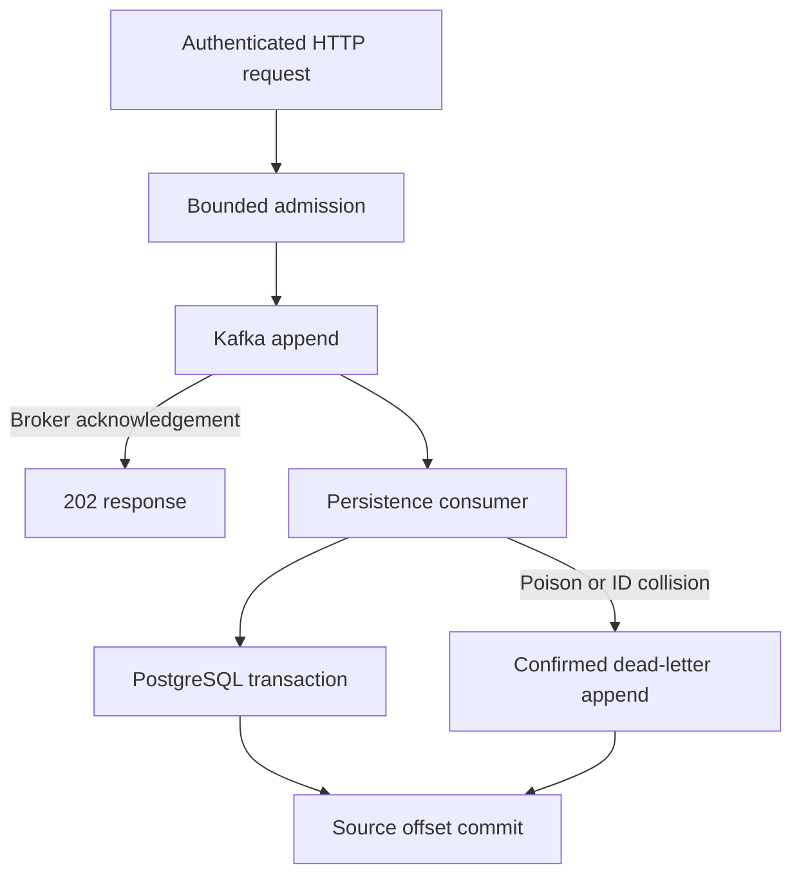

# Architecture and delivery decisions

## Scope

This prototype addresses a narrow problem: accept versioned telemetry into a
broker, persist it across retries, and explain what a client can conclude from
each response. It does not attempt stream analytics, a general schema registry,
a query warehouse or a multi-region control plane.

## Decision 1: acknowledge the broker, then persist

Holding the HTTP request open for database persistence couples intake availability
to database availability. Returning before the broker acknowledgement can claim
acceptance for a record that never entered the log. This implementation chooses
the broker acknowledgement as its boundary.

The producer uses `acks=all` and Kafka producer idempotence. These do not provide
application-level exactly-once delivery: producer restarts and client retries can
still generate duplicate records. Replication factor, minimum ISR, unclean leader
election and the storage fault model determine what an acknowledgement survives.

The demo explicitly uses replication factor 1 and minimum ISR 1. The replicated
configuration requests factor 3 and minimum ISR 2, with unclean leader election
disabled; a three-broker cluster and failure tests remain prerequisites.

## Decision 2: a database key and canonical fingerprint

The database primary key is `(tenant_id, event_id)`. `INSERT ... ON CONFLICT DO
NOTHING` runs inside a transaction. A duplicate key triggers comparison with a
SHA-256 fingerprint of the original logical payload.

The canonical encoding uses length-prefixed UTF-8 fields and sorted attribute
keys, so JSON object ordering does not cause a false collision. The event's
timestamp retains its original precision in that fingerprint even though
PostgreSQL timestamps have microsecond precision.

An identical retry succeeds as a duplicate. A different payload for the same
key raises a collision and goes to the dead-letter topic. The first database
writer wins; no client-side version update or HTTP `409` is implied.

A crash after database commit and before source-offset commit produces replay.
The same insert-and-compare transaction makes that replay safe. There is no
distributed transaction across PostgreSQL and Kafka.

## Decision 3: bound admitted sends

One short synchronized critical section acquires both global and per-tenant
capacity. Tenant entries exist only while they hold a lease, so the tracking map
cannot grow with historical tenant count. A fixed worker pool isolates Kafka
send initiation, which can block on metadata or producer buffer availability,
from the Netty event loop.

A lease remains held until the actual broker completion, including after an HTTP
subscriber cancels. Clients cannot cancel the internal result future through
the public completion stage. Drain stops new admission and waits for admitted
operations; reaching the shutdown deadline does not manufacture acknowledgements.

This bounds admitted operations, not HTTP connection count, parsing allocations,
fleet-wide load or a tenant's requests per second. The per-tenant cap is an
occupancy limit, not a fairness scheduler or rate limiter. An API gateway and
fleet admission policy would be separate decisions.

The worker queue has finite size but no independent queue-age deadline.
With unavailable broker metadata, the default capacities and `max.block.ms`
can lead to substantial queue wait. Queue-age cancellation before send,
instrumentation and overload latency testing are explicit follow-up work.

## Decision 4: retry dependency outages, quarantine poison

A persistence failure leaves the source offset uncommitted and retries. This
preserves work during a recoverable database outage at the cost of blocking that
partition. A malformed envelope or payload collision is non-retryable: publish
the original record to the corresponding dead-letter partition, wait for broker
confirmation, then commit the source offset. If dead-letter publication fails,
recovery fails and the source offset must remain uncommitted.

The dead-letter topic has the same partition count as the source. A separate
operational replay policy is required. Blindly republishing collisions would
repeat the same failure.

## Event contract

Timestamps are restricted to UTC years 0001 through 9999. Attribute values are
limited to 128 UTF-16 code units and must contain valid Unicode scalar values
without U+0000. These checks avoid accepting payloads that PostgreSQL JSONB or
the JDBC timestamp conversion cannot represent.

## Ordering and retention

The Kafka key is `tenant_id:event_id`: retries of one ID share a partition.
There is no total ordering across a tenant, session or cluster.

Source and dead-letter retention use Kafka broker defaults in the demo. During
an outage longer than retention, unprocessed events can expire. PostgreSQL event
retention, partition lifecycle and deletion workflows are not implemented.
Production claims require an explicit backlog/retention budget and storage plan.
